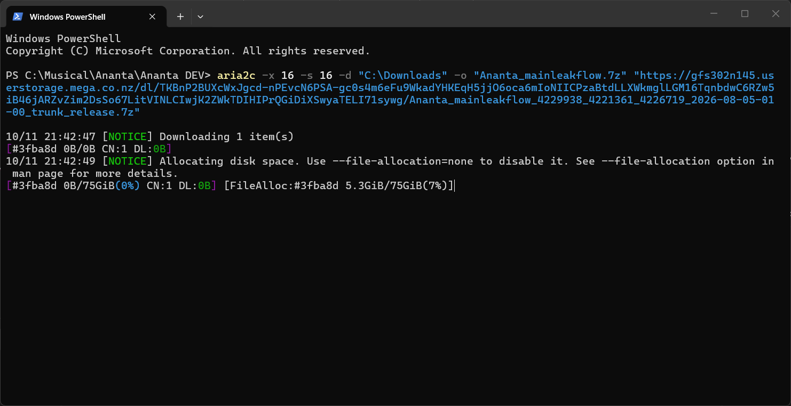

# 🚀 File Hosting & aria2c Download Guide

คู่มือสรุปคำสั่งใช้งาน **aria2c** สำหรับดาวน์โหลดไฟล์ความเร็วสูงจากผู้ให้บริการฝากไฟล์ยอดนิยม (**Pixeldrain**, **Gofile**, **Transfer.it**) พร้อมวิธีจัดการงานดาวน์โหลด

---

## 🖼️ ตัวอย่างการใช้งานจริง (Example)

ภาพตัวอย่างการรันคำสั่ง `aria2c` ผ่าน PowerShell เพื่อดาวน์โหลดไฟล์ขนาดใหญ่ด้วยความเร็วสูง:



---

## 📂 รายชื่อบริการฝากไฟล์ที่รองรับ

| บริการ | คุณลักษณะ | รูปแบบลิงก์ตรง |
| :--- | :--- | :--- |
| **Pixeldrain** | สปีดแรง ไม่ค่อยจำกัดความเร็ว | `https://pixeldrain.com/api/file/FILE_ID` |
| **Gofile** | รองรับไฟล์ขนาดใหญ่ | `https://storeX.gofile.io/download/web/...` |
| **Transfer.it** | รับ-ส่งไฟล์ขนาดใหญ่ผ่านลิงก์ชั่วคราว | `https://transfer.it/...` |

---

## 🛠️ ตัวอย่างคำสั่งดาวน์โหลดความเร็วสูง (aria2c)

### 1. Pixeldrain
```powershell
aria2c -x16 -s16 "[https://pixeldrain.com/api/file/FILE_ID](https://pixeldrain.com/api/file/FILE_ID)"

```

### 2. Gofile

```powershell
aria2c -x16 -s16 "[https://storeX.gofile.io/download/web/FILE_ID/filename.zip](https://storeX.gofile.io/download/web/FILE_ID/filename.zip)"

```

### 3. Transfer.it

```powershell
aria2c -x16 -s16 "[https://transfer.it/FILE_ID](https://transfer.it/FILE_ID)"

```

### 4. กำหนดโฟลเดอร์ปลายทาง

```powershell
aria2c -x16 -s16 -d "D:\Downloads" "[https://example.com/file.zip](https://example.com/file.zip)"

```

---

## 🛑 การหยุด, ยกเลิก และดาวน์โหลดต่อ (Stop, Resume & Delete)

### 1. หยุดชั่วคราว / ยกเลิกงานระหว่างโหลด (ใน Terminal)

* กดปุ่ม **`Ctrl + C`** บนคีย์บอร์ด
* ระบบจะหยุดโหลดและสร้างไฟล์ `.aria2` เก็บไว้ เพื่อให้สามารถกดรันคำสั่งเดิมเพื่อ **โหลดต่อจากเดิม (Resume)** ได้ในภายหลัง

### 2. วิธีโหลดต่อจากจุดเดิม (Resume)

* เพียงแค่รัน **คำสั่งดาวน์โหลดเดิม** ซ้ำอีกครั้ง aria2c จะตรวจสอบไฟล์เก่าและโหลดส่วนที่เหลือต่อให้ทันทีโดยไม่ต้องเริ่มใหม่

### 3. ลบงานดาวน์โหลดทิ้งแบบถาวร (ไม่โหลดต่อแล้ว)

1. ปิดหน้าต่าง Terminal หรือหยุดคำสั่ง
2. เข้าไปลบไฟล์ที่ค้างอยู่ รวมถึง ไฟล์นามสกุล `.aria2**` ในโฟลเดอร์ปลายทางทิ้ง
3. หากลบไฟล์ `.aria2` ทิ้ง เมื่อสั่งโหลดใหม่ ไฟล์จะเริ่มนับ 0% ใหม่ทั้งหมด

---

## ⚙️ สรุปตัวเลือกพารามิเตอร์สำคัญ

* `-x16` : เปิดการเชื่อมต่อสูงสุด 16 Connections ต่อเซิร์ฟเวอร์
* `-s16` : แบ่งไฟล์ออกเป็น 16 ส่วนดาวน์โหลดพร้อมกัน
* `-d` : ระบุโฟลเดอร์สำหรับบันทึกไฟล์
* `--file-allocation=none` : ข้ามการจองพื้นที่ดิสก์ล่วงหน้า ช่วยให้เริ่มดาวน์โหลดทันที